# 🪙 Coin Cataloguing: from scans to a priced spreadsheet

This project turns photos of many coins into a catalogue. It detects every coin, pairs its front (`..._v.jpg`) and back (`..._r.jpg`), groups duplicates, and identifies each coin with a vision LLM. It then looks up catalogue data and prices on [Numista](https://en.numista.com) and writes everything to a spreadsheet, so the most valuable coins are easy to find and sell.

## Pipeline & status

| # | Stage | Script | Output (`results/<run>/`) | Status |
|---|---|---|---|---|
| 1 | Detect, pair & extract coins (OpenCV) | `main.py` | `extraction_results.json` | ✅ |
| 2 | Cluster duplicates (ResNet50 + DBSCAN) | `clustering.py`, `check_clusters.py` | `extraction_results_with_groups.json` | ✅ prototype |
| 3 | Identify each coin (Claude vision, Batch API) | `identify.py` | `identifications.jsonl` | ✅ built, waiting for API key |
| 4 | Catalogue match + prices (Numista free API) | `numista.py` | `numista_matches.jsonl` | ✅ tested on 6 coins |
| 5 | Spreadsheet (+ manual `overrides.csv`) | `build_table.py` | `coins.xlsx` | ✅ |

👉 The plan, cost estimates and design decisions are in **[docs/PLAN.md](docs/PLAN.md)**.

---

## Features

- 👁️ **Coin Detection**: Uses OpenCV (Canny edge detection, contour finding) to identify coin-like objects.
- 🧹 **Smart Filtering**: Filters out nested contours (e.g., details *inside* a coin) and non-square objects to isolate coins.
- 🤝 **Automatic Pairing**: Matches front-side images (e.g., `..._v.jpg`) with their corresponding back-side images (`..._r.jpg`).
- 📏 **Row-Based Matching**: Assigns detected coins to rows and matches them by their horizontal order, ensuring `coin 1 front` matches `coin 1 back`.
- ✂️ **Image Extraction**: Saves each matched pair of coin images as individual PNG files.
- 🐞 **Debug Mode**: Can generate a full suite of debug images showing each step of the CV pipeline (edges, contours, bounding boxes).
- 📊 **JSON Report**: Outputs a `extraction_results.json` file detailing all extracted coins, their source files, and their coordinates.

---

## How it Works: The CV Pipeline

The script processes images by finding edges, filtering contours, assigning rows, and then matching pairs.

### 1. Original Images

The script expects paired front (`_v`) and back (`_r`) images in the `images/` directory.

| Front (`b2_s1_v.jpg`) | Back (`b2_s1_r.jpg`) |
| :---: | :---: |
| 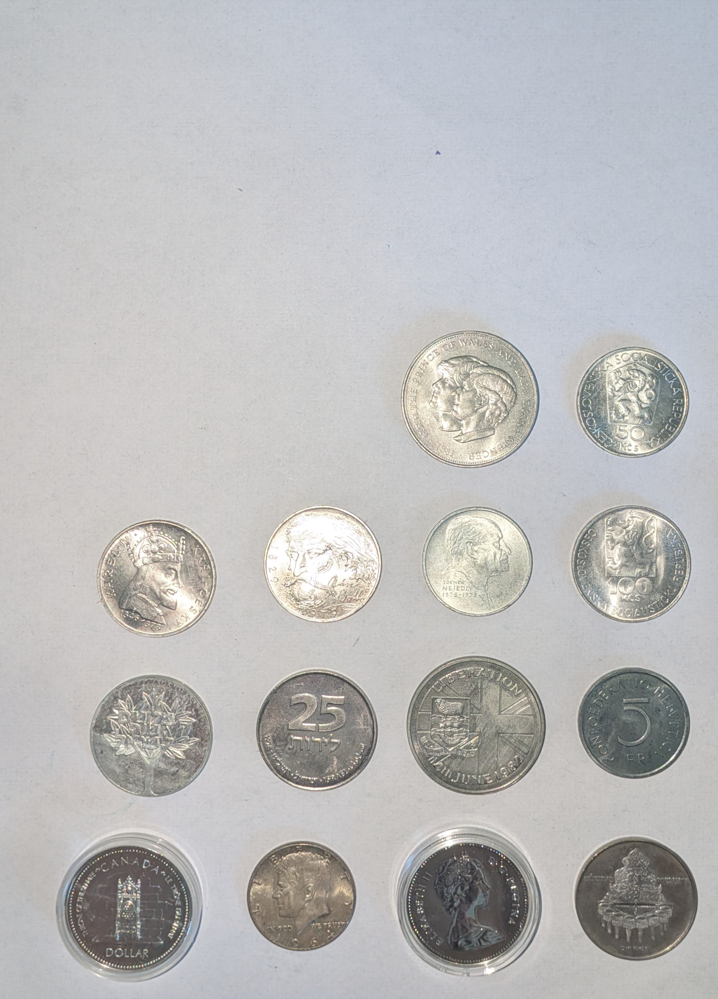 | 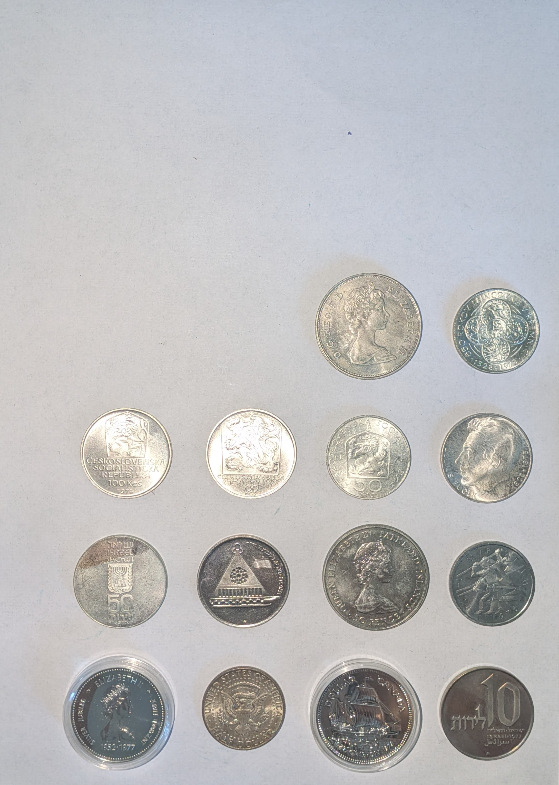 |

### 2. Debug & Detection Steps

When `save_debug=True`, the script saves its work into the `results/TIMESTAMP/debug/` folder.

| Edges | Dilated Edges | All Contours |
| :---: | :---: | :---: |
| 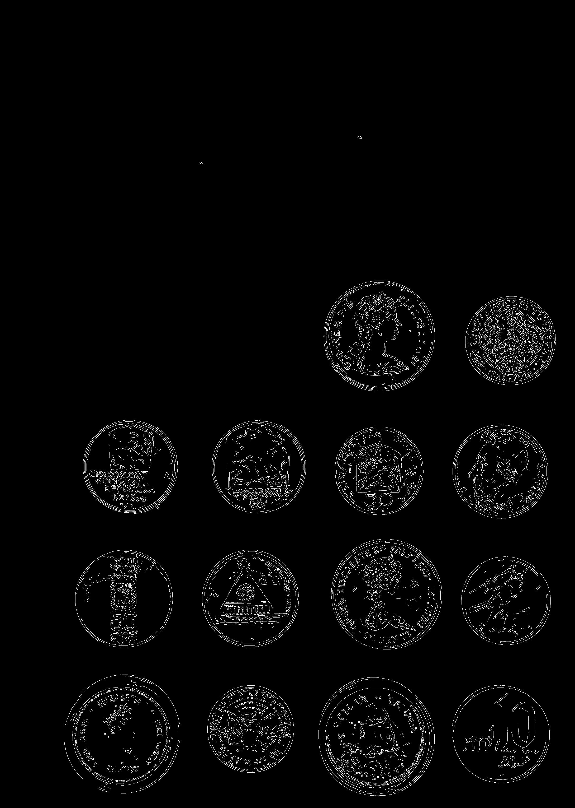 | 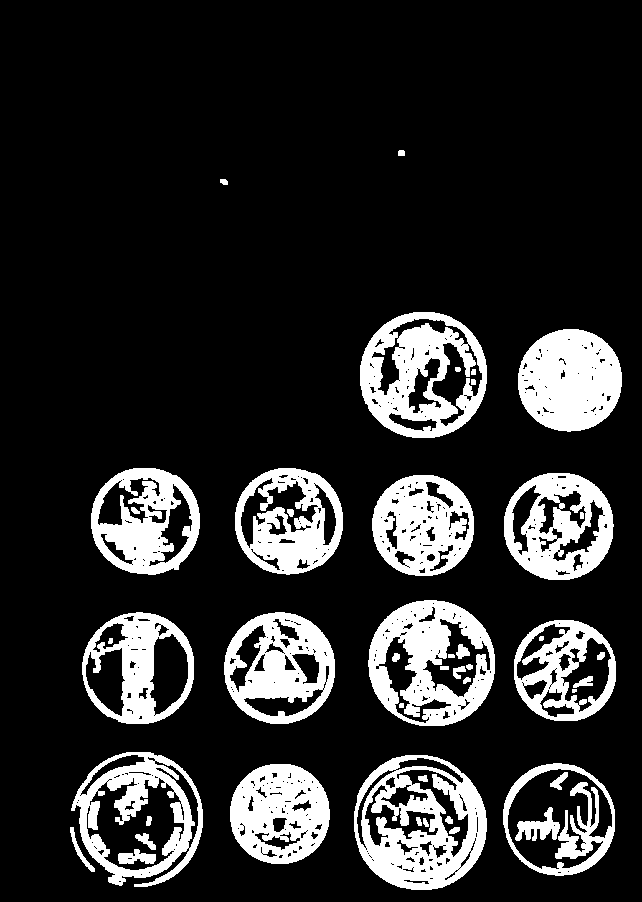 | 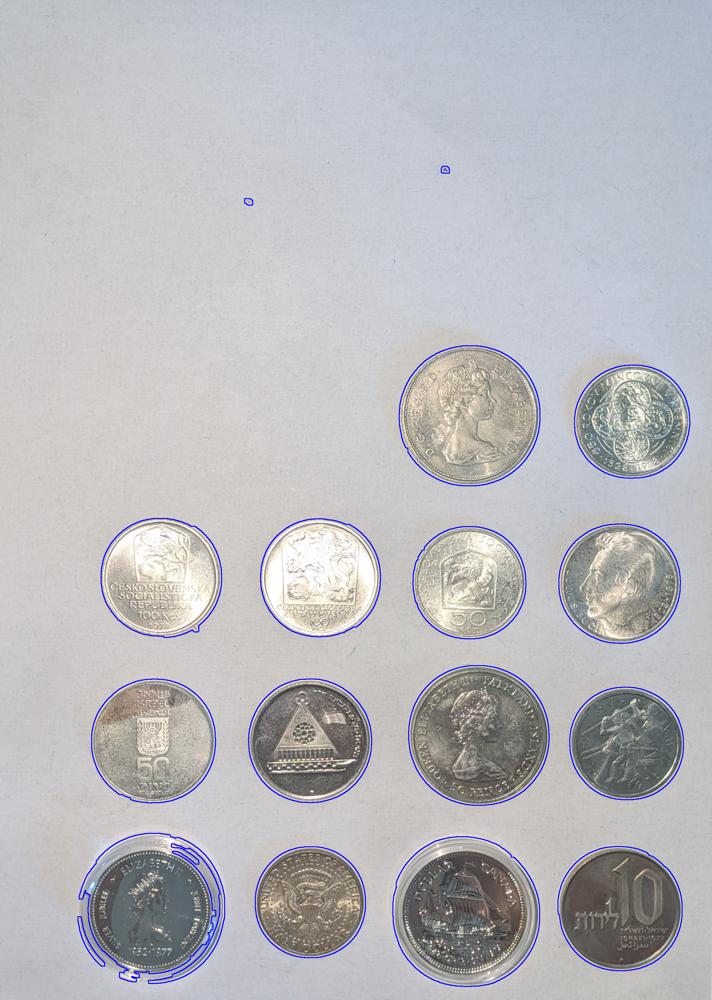 |
| **Filtered Contours** | **Row Assignment** | **Final Extraction Overview** |
| 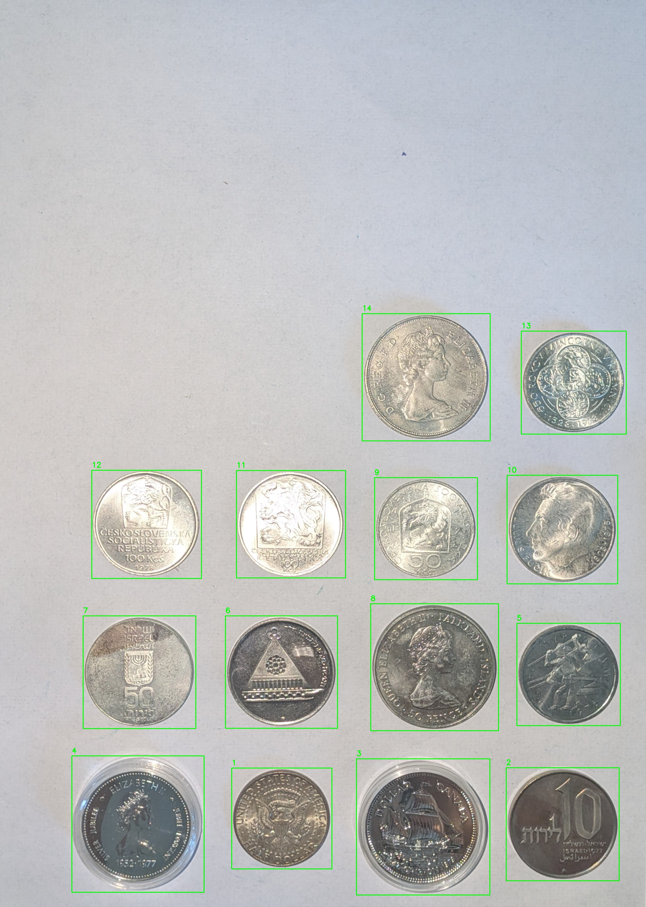 | 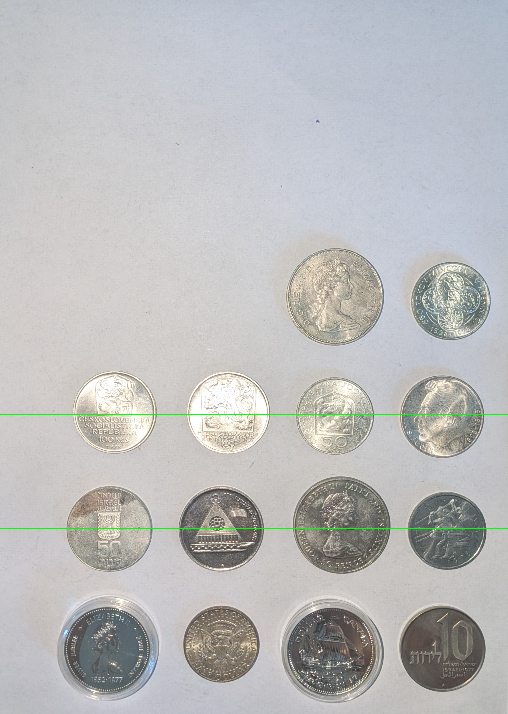 | 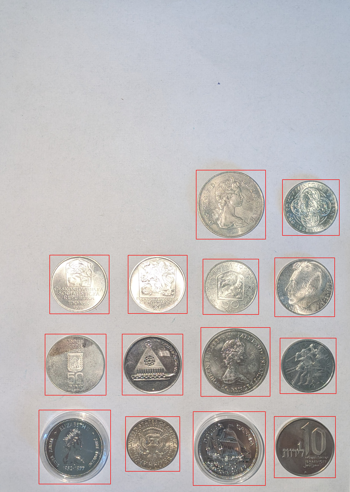 |

### 3. Extracted Coin Pairs

The final output is saved in `results/TIMESTAMP/extracted/`. The naming convention ensures front and back images sort next to each other.

| Coin 1 (Front / Back) |
| :---: |
| 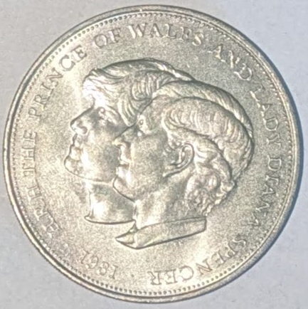 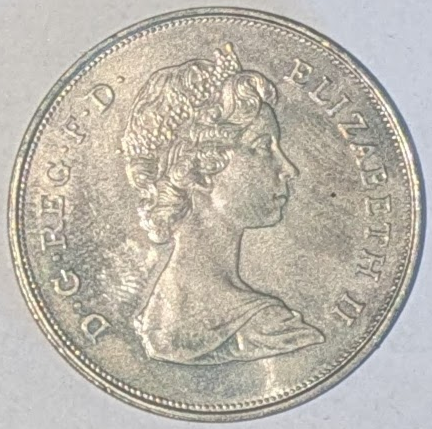 |
| **Coin 4 (Front / Back)** |
| 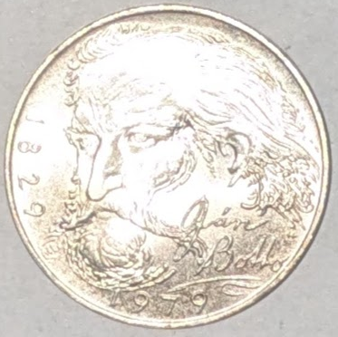 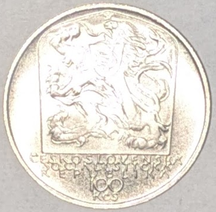 |
| **Coin 8 (Front / Back)** |
| 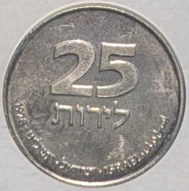 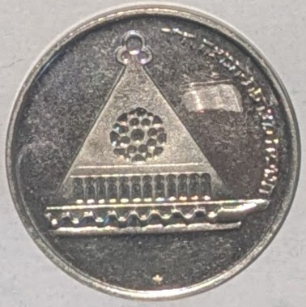 |

---

## Prerequisites

- **Python** ≥ 3.12, **[uv](https://docs.astral.sh/uv/)** as the package/environment manager
- For clustering: an NVIDIA GPU is recommended (developed on an RTX 5070 Ti, CUDA 12.8)
- **Input Directory**: An `images/` directory in the root of the project.
- **Naming Convention**: Input images *must* be named with `..._v.jpg` for the front side (Vorderseite) and `..._r.jpg` for the back side (Rückseite).

---

## Installation & Setup (Recommended with uv)

### 1) Install uv

- **macOS / Linux (Shell):**
  ~~~bash
  curl -LsSf https://astral.sh/uv/install.sh | sh
  ~~~

- **Windows (PowerShell):**
  ~~~powershell
  iwr https://astral.sh/uv/install.ps1 -UseBasicParsing | iex
  ~~~

> See the official uv documentation for alternatives.

### 2) Install Dependencies

~~~bash
uv sync
~~~

PyTorch is pulled from the CUDA 12.8 index on Windows/Linux (see `[tool.uv.sources]` in `pyproject.toml`) and from PyPI on macOS.

### 3) API keys (stages 3–4)

Create a `.env` file in the project root. It is gitignored.

~~~
ANTHROPIC_API_KEY=...
NUMISTA_API_KEY=...        # free plan: 2000 requests/month, https://en.numista.com/api/
SILVER_EUR_PER_G=...       # EUR per gram of pure silver; update by hand before valuing / selling
GOLD_EUR_PER_G=...
ASSUMED_GRADE=xf           # g, vg, f, vf, xf, au, unc: grade used for the value estimate
~~~

---

## Usage

~~~bash
uv run main.py                 # 1) detect & extract → results/<timestamp>/extraction_results.json
uv run clustering.py           # 2) embed + cluster        (all stages take --run results/<timestamp>)
uv run check_clusters.py       #    one folder per cluster for visual review + histogram
uv run identify.py --estimate  # 3) free token count → cost projection
uv run identify.py --sample 30 #    ~$1 test run, prints measured cost per coin
uv run identify.py --batch     #    submit the rest via the Batch API (50 % cheaper)
uv run identify.py --collect --wait
uv run numista.py              # 4) Numista match + prices, stops at the monthly budget
uv run numista.py --status     #    quota used this month
uv run build_table.py          # 5) → results/<run>/coins.xlsx (offline, re-run any time)
uv run review_outliers.py      #    → outlier_review.xlsx: doubtful high-value matches to check by hand
~~~

### Results and re-valuing

`build_table.py` writes into the run folder:

- `coins.xlsx` has the sheets **Summary**, **Highlights** (confidently valuable coins), **Coins**, **Types**, **Top** and **Review**.
- `highlights.md` is the same highlights list as Markdown, with Numista, eBay-sold and image links.
- `valuation.json` records the silver/gold €/g and grade that the values are based on, and when they were taken.
- `crops/` holds a front and back JPG for every coin. The sheets link to them.

Melt value, estimated value and the totals are **Excel formulas** on the yellow cells `Summary!B3` (silver €/g) and `B4` (gold €/g). Change them in Excel and everything recalculates. Alternatively, update `SILVER_EUR_PER_G` / `GOLD_EUR_PER_G` in `.env` and re-run `uv run build_table.py`, which also refreshes the sorting, the highlights and `valuation.json`. Numista prices are cached; the month they were fetched is shown in the Summary sheet.

To send the table to someone else, run `uv run build_table.py --share`. This writes `coins_share.xlsx` with fixed values instead of formulas, because email and phone previews don't calculate formulas. It also has no links to files on this PC, bigger pictures, all highlights and no Review sheet (about 13 MB).

The default run is set in `coins_common.py` (`DEFAULT_RUN`). Use **one** results run for all stages, because coin numbering changes whenever extraction changes. Coins are referred to by `coin_id = <pair_key>_coin<coin_number>` (e.g. `b2_s1_coin3`).

---

## Output Structure

The script generates a new folder `results/` with a timestamped subfolder for each run.

~~~
results/
└── 2025_11_08_12_30_00/
    ├── debug/
    │   ├── b2_s1_r_all_contours.png
    │   ├── b2_s1_r_edges.png
    │   ├── b2_s1_r_edges_dilated.png
    │   ├── b2_s1_r_kept_rectangles.png
    │   ├── b2_s1_r_rows.png
    │   └── ... (many more)
    ├── extracted/
    │   ├── b2_s1_coin1_back.png
    │   ├── b2_s1_coin1_front.png
    │   ├── b2_s1_coin2_back.png
    │   ├── b2_s1_coin2_front.png
    │   └── ... (all extracted pairs)
    ├── b2_s1_r_extracted.png
    ├── b2_s1_v_extracted.png
    └── extraction_results.json
~~~

### `extraction_results.json` Format

This file contains a list of all successfully matched and extracted coin pairs, perfect for feeding into another process.

~~~json
[
  {
    "pair_key": "b2_s1",
    "coin_number": 1,
    "front_image": "b2_s1_v.jpg",
    "back_image": "b2_s1_r.jpg",
    "front_extracted": "results/2025_11_08_12_30_00/extracted/b2_s1_coin1_front.png",
    "back_extracted": "results/2025_11_08_12_30_00/extracted/b2_s1_coin1_back.png",
    "front_rect": {
      "x": 100,
      "y": 150,
      "w": 300,
      "h": 300
    },
    "back_rect": {
      "x": 102,
      "y": 148,
      "w": 301,
      "h": 301
    }
  },
  {
    "pair_key": "b2_s1",
    "coin_number": 2,
    "front_image": "b2_s1_v.jpg",
    "back_image": "b2_s1_r.jpg",
    "...": "..."
  }
]
~~~

---

## Development

- **Format/Lint** using [Ruff](https://docs.astral.sh/ruff/) (via uv):
  ~~~bash
  uv run ruff check --fix
  uv run ruff format
  ~~~

- **Quick Start in venv**:
  ~~~bash
  source .venv/bin/activate       # Linux/macOS
  .venv\Scripts\activate          # Windows
  python extract_coin_images.py --save-extracted
  ~~~

---

## Working with Claude Code

Project skills live in `.claude/skills/`:

| Skill | Use it for |
|---|---|
| `coin-pipeline` | Running or implementing pipeline stages, conventions, cost and quota rules |
| `identify-coins` | Identifying or verifying specific coins (review queue, high-value coins) and writing `overrides.csv` |
| `tune-clustering` | Improving duplicate clustering (eps, DINOv2, swapped sides, rotation) |

`uv run python .claude/skills/identify-coins/crop_pair.py <coin_id> | --group <id>` renders front and back side by side for quick review.

---

## Roadmap

See [docs/PLAN.md](docs/PLAN.md). In short: LLM identification of every coin, then Numista text search and prices (free tier), then `coins.xlsx` with melt value, Numista prices, proof links and a review sheet. A GUI is intentionally out of scope: Excel plus `overrides.csv` replaces it.

Detection ideas for later: `cv2.HoughCircles` instead of contour filtering, or a small YOLO model.

---

## Disclaimer

This tool is provided for personal and educational use. The author is not responsible for any errors in detection, data loss, or any financial decisions made based on the script's output. Always double-check valuable items manually.